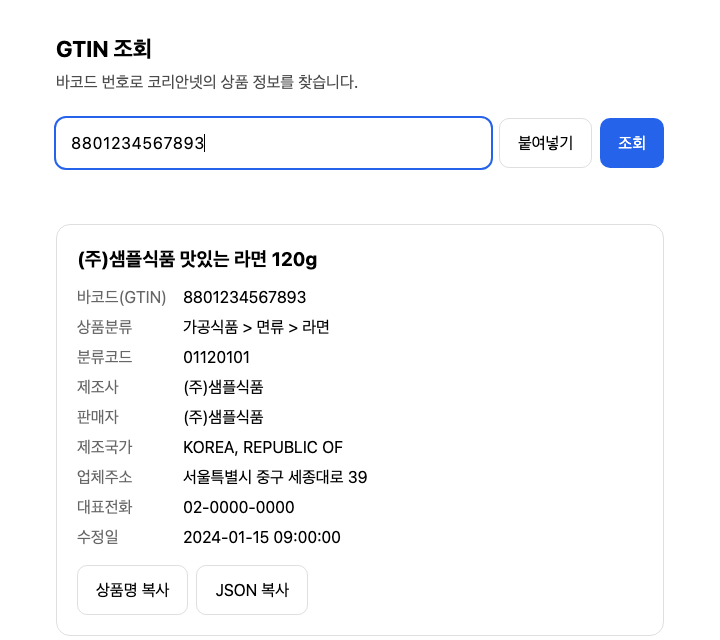
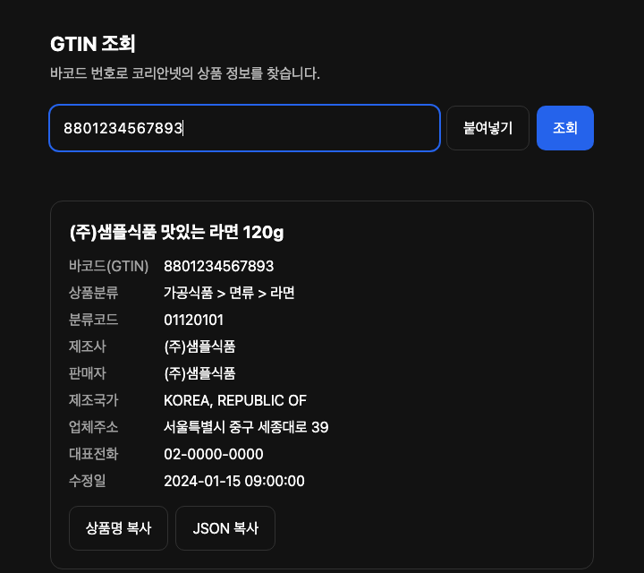
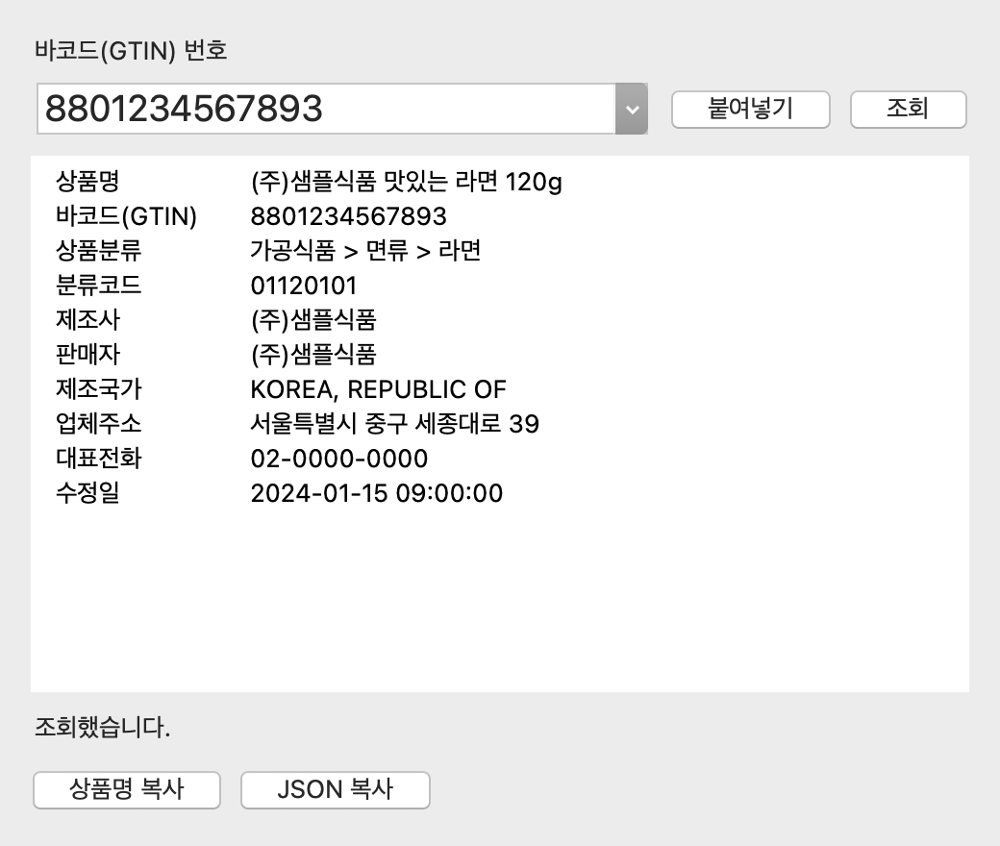
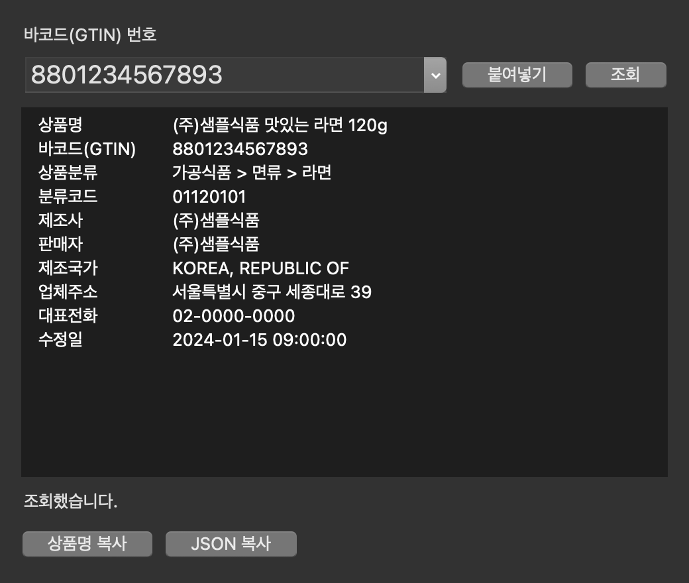

# koreannet-gtin

[](https://github.com/leejongyoung/koreannet-gtincode/actions/workflows/ci.yml) [](https://github.com/leejongyoung/koreannet-gtincode/releases)   [](LICENSE) [](https://docs.astral.sh/ruff/)

[English](README.md)

대한민국 GTIN(표준바코드) 번호로 [코리안넷](https://www.koreannet.or.kr/)(대한상공회의소 유통물류진흥원)에서 상품 정보를 조회합니다. 하나의 패키지를 다섯 가지 방식으로 쓸 수 있습니다.

| | |
|---|---|
| **Python 라이브러리** | `from koreannet_gtin import lookup` |
| **CLI** | `koreannet-gtin 8801045759296` |
| **데스크톱 GUI** | `koreannet-gtin gui` (tkinter) |
| **브라우저 화면** | `koreannet-gtin web` (휴대폰·서버에서도 사용 가능) |
| **Docker** | `docker run -p 127.0.0.1:8765:8765 ghcr.io/leejongyoung/koreannet-gtincode` |

Windows, macOS, Linux, Android(Termux)에서 Python 3.9 이상으로 동작합니다.

| 라이트 | 다크 |
|:---:|:---:|
|  |  |

## 설치

```sh
# 권장: 독립된 명령줄 도구로 설치
uv tool install git+https://github.com/leejongyoung/koreannet-gtincode
# 또는
pipx install git+https://github.com/leejongyoung/koreannet-gtincode
```

Python 없이 쓰는 Windows/macOS/Linux 실행 파일(CLI·GUI)은 [릴리스](https://github.com/leejongyoung/koreannet-gtincode/releases)에 올라옵니다.

| 플랫폼 | CLI | GUI 창 | 브라우저 화면 |
|---|---|---|---|
| Windows / macOS / Linux | 지원 | 지원 | 지원 |
| Android (Termux) | 지원 | tkinter 없음 | 지원 |
| iPhone / iPad | – | – | PC에서 `web --host 0.0.0.0`을 켜고 그 주소로 접속 |

참고: Linux에서 GUI는 `python3-tk`가 필요합니다(`sudo apt install python3-tk`). macOS는 python.org·Homebrew·`uv`의 Python을 쓰세요. Apple이 제공하는 Python 3.9는 Tk 8.5라서 최신 macOS에서 멈춥니다.

## CLI

```console
$ koreannet-gtin 8801045759296
바코드(GTIN)  8801045759296
상품명        (주)오뚜기 프레스코 베이컨 감자스프 180g
상품분류      가공식품 > 즉석/편의식품 > 즉석/조리식품 > 즉석스프
제조사        (주)오뚜기
...
```

```sh
koreannet-gtin 8801045759296 --json            # JSON (번호가 여러 개면 목록)
koreannet-gtin 8801045759296 --name-only       # 상품명만
koreannet-gtin -f codes.txt --csv > out.csv    # 파일로 일괄 조회 ('#' 주석 가능)
cat codes.txt | koreannet-gtin - --json        # 표준 입력으로 일괄 조회
koreannet-gtin check 8801045759296             # 체크디지트만 검사 (네트워크 사용 안 함)
koreannet-gtin web --port 8765                 # http://127.0.0.1:8765/ 에서 브라우저 화면
```

종료 코드: `0` 모두 성공, `1` 하나 이상 실패, `2` 사용법 오류. 여러 개를 조회할 때는 요청 사이에 `--delay`초(기본 1초)를 기다립니다.

요청 전에 입력을 검증합니다. GTIN-8, 12(UPC-A), 13(EAN-13), 14자리와 GS1 체크디지트를 확인하고, 공백·하이픈은 무시합니다.

## 데스크톱 GUI

`koreannet-gtin gui`(또는 `koreannet-gtin-gui` 실행기, 릴리스의 GUI 실행 파일)로 tkinter 창을 엽니다. 번호를 입력하거나 붙여넣고 Enter를 누르면 조회하고, 상품명이나 전체 JSON을 복사할 수 있습니다. 조회는 백그라운드에서 돌아 창이 멈추지 않습니다.

| 라이트 | 다크 |
|:---:|:---:|
|  |  |

## Docker

```sh
# 브라우저 화면: http://127.0.0.1:8765/ (로그인이 없는 서버이므로 localhost에만 묶으세요)
docker run -d --name koreannet-gtin -p 127.0.0.1:8765:8765 ghcr.io/leejongyoung/koreannet-gtincode

# CLI: 인자를 주면 기본 명령(`web`) 대신 실행됩니다
docker run --rm ghcr.io/leejongyoung/koreannet-gtincode 8801045759296 --json
docker run --rm -v "$PWD:/data" ghcr.io/leejongyoung/koreannet-gtincode -f /data/codes.txt --csv

# 직접 빌드하거나 Compose 사용
docker build -t koreannet-gtin . && docker compose up -d
```

이미지는 멀티 아키텍처(amd64, arm64)이고, 비루트 사용자로 실행되며, `--read-only --cap-drop ALL`에서도 동작하고, 헬스체크가 있습니다. CLI와 브라우저 화면만 들어 있습니다. tkinter 창은 데스크톱이 필요하므로 일반 설치로 쓰세요. 이미지는 `v*` 태그를 푸시하면 GitHub Container Registry에 올라갑니다. 저장소가 private인 동안에는 먼저 `docker login ghcr.io`를 하세요.

## Python

```python
from koreannet_gtin import lookup, NotFoundError, InvalidGTINError

try:
    product = lookup("8801045759296")
except InvalidGTINError as e:   # 자릿수·체크디지트 오류. 요청을 보내지 않음
    ...
except NotFoundError:           # 코리안넷에 등록되지 않음
    ...

print(product.name)             # (주)오뚜기 프레스코 베이컨 감자스프 180g
print(product.manufacturer, product.category, product.to_dict())
```

예외는 모두 `KoreannetError`를 상속합니다: `InvalidGTINError`, `NotFoundError`, `NetworkError`, `ParseError`(페이지 구조 변경). `lookup(gtin, session=..., timeout=...)`에 직접 만든 `requests.Session`을 넘길 수 있습니다.

### 1.x에서 옮기기

`from koreannet.gtin import Search` → `from koreannet_gtin import lookup`. `Search(...).search_gtin()`은 `message`가 든 dict를 돌려줬지만, `lookup()`은 `Product`를 돌려주고 실패하면 예외를 일으킵니다. `requirements.txt`, `main.py`, `main-gui.py`는 `koreannet-gtin` 명령으로 대체되었고 `pyperclip`은 더 이상 필요 없습니다.

## 데이터에 대해

결과는 코리안넷의 공개 검색 페이지에서 가져오며 공식 API를 쓰지 않습니다. 코리안넷은 페이지에서 정보가 대한상공회의소의 귀속 자산이며 무단 수집·유통은 법적 제재를 받을 수 있다고 밝히고, `robots.txt`로 `/front/koreannet/gtinSrch*`의 크롤링을 막고 있습니다. 가끔 개별 상품을 조회하는 용도로만 쓰고, 일괄 조회의 기본 대기 시간을 유지하며, 데이터를 복제·재배포하지 마세요. 페이지 구조가 예고 없이 바뀔 수 있으며, 바뀌면 엉뚱한 값 대신 `ParseError`가 발생합니다.

## 개발

```sh
python -m venv .venv && . .venv/bin/activate   # Windows: .venv\Scripts\activate
pip install -e ".[dev]"
pytest && ruff check . && ruff format --check .
```

[CONTRIBUTING.md](CONTRIBUTING.md)를 보세요. MIT 라이선스([LICENSE](LICENSE)).
